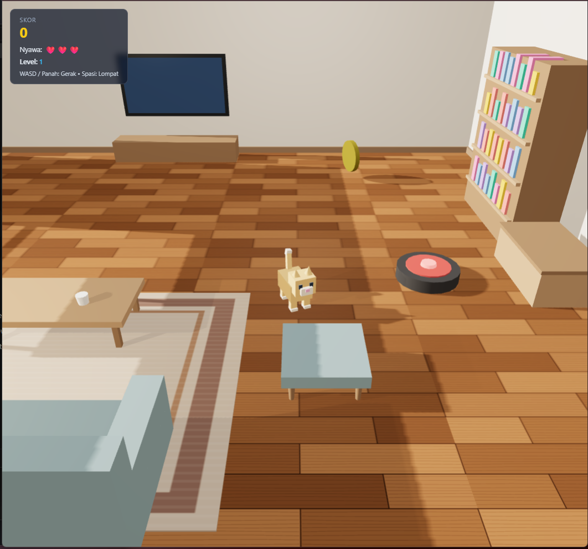

# 🐱 Coin Rush 3D

Game 3D ringan berbasis browser: kendalikan seekor kucing low-poly di dalam ruang tamu, kumpulkan kristal, dan hindari robot vacuum. Ditulis dengan JavaScript ES modules biasa, tanpa build tool dan tanpa aset eksternal.



> Ganti gambar di atas dengan screenshot game kamu (simpan di folder `screenshots/`).

---

## ✨ Fitur

- 🏠 **Ruang tamu 3D** dengan lantai kayu prosedural, dinding, jendela, dan cahaya matahari
- 🛋️ **Perabotan** dari bentuk dasar: sofa, meja kopi, karpet, rak, TV, tanaman, lampu berdiri
- 🐈 **Karakter kucing** low-poly yang menghadap arah gerak dengan halus (interpolasi sudut jalur terpendek)
- 🎮 **Gerakan WASD relatif kamera** dengan animasi kaki, ekor, dan efek bernapas saat diam
- 💎 **Item koleksi** yang berputar dan melayang, muncul di posisi acak yang aman
- 🤖 **Rintangan** robot vacuum yang bergerak bolak-balik
- ❤️ **Sistem nyawa, skor, dan level** dengan kesulitan yang meningkat
- 🌟 **Visual HD ringan**: antialiasing, shadow map 2048, tone mapping ACES Filmic, partikel debu cahaya
- ⚡ **Ringan**: tanpa model eksternal, tanpa post-processing berat

## 🎮 Cara Bermain

| Tombol | Aksi |
|---|---|
| `W` `A` `S` `D` / Panah | Bergerak |
| `Spasi` | Lompat |

**Aturan:**

1. Ambil kristal untuk mendapat **+10 skor**.
2. Hindari robot vacuum. Setiap tabrakan mengurangi **1 nyawa** (total 3 nyawa).
3. Setiap 5 kristal, level naik: rintangan bergerak lebih cepat dan jumlahnya bertambah.
4. Nyawa habis = **Game Over**. Tekan **Main Lagi** untuk mengulang.

## 🚀 Menjalankan Game

Kode game memakai ES modules, jadi harus dijalankan lewat server lokal (membuka `index.html` langsung dari file tidak akan berjalan).

```bash
git clone https://github.com/USERNAME/coin-rush-3d.git
cd coin-rush-3d
npm start            # = npx serve .
```

Lalu buka `http://localhost:3000`.

Alternatif tanpa Node.js: `python -m http.server 8000`, lalu buka `http://localhost:8000`.

> Three.js dimuat dari CDN, jadi butuh koneksi internet saat pertama kali membuka game.

## 🧰 Teknologi

- [Three.js](https://threejs.org/) untuk rendering 3D
- JavaScript (vanilla), HTML, dan CSS
- Tekstur prosedural dengan Canvas API
- `requestAnimationFrame` dengan delta time agar gerakan stabil di berbagai FPS

## 📁 Struktur Proyek

```
coin-rush-3d/
├── index.html        # Canvas, UI, importmap Three.js
├── css/style.css     # Gaya UI
├── js/
│   ├── main.js       # Entry point & game loop
│   ├── config.js     # Semua angka penyetelan
│   ├── core/         # Renderer, input, state, kamera, audio
│   ├── world/        # Ruangan, perabotan, lampu, tekstur
│   ├── entities/     # Kucing, robot vacuum, item, partikel
│   ├── systems/      # Tabrakan, spawn, skor/nyawa/level
│   └── ui/           # HUD, layar game over
├── package.json      # Script "npm start"
├── screenshot/       # Gambar untuk README
└── README.md
```

Detail arsitektur dan aturan pengembangan ada di [CLAUDE.md](CLAUDE.md).

## 🗺️ Roadmap

- [x] Scene 3D, kontrol, skor, nyawa, level
- [x] Tema dalam ruangan dengan perabotan
- [x] Karakter kucing dengan rotasi dan animasi halus
- [ ] Kucing bisa melompat naik ke perabotan
- [ ] Efek suara memakai Web Audio API
- [ ] Power-up (misalnya magnet koin)
- [ ] Mode level dengan layout ruangan berbeda
- [ ] Dukungan layar sentuh (joystick virtual)
- [ ] Penyimpanan high score

## 🤖 Catatan Pengembangan

Proyek ini dibuat sebagai uji coba kemampuan AI coding assistant (Antigravity dengan model Gemini 4 Hydrogen Medium) melalui prompt bertahap: dari prototipe bola sederhana, lalu transformasi menjadi ruangan, karakter kucing, dan perbaikan iteratif.

## 🐞 Masalah Umum

| Masalah | Solusi |
|---|---|
| Layar kosong / hitam | Pastikan internet aktif (Three.js dari CDN), lalu buka Console (`F12`) untuk melihat error |
| FPS rendah | Turunkan pixel ratio atau kurangi kualitas shadow di kode |
| Kamera terhalang perabotan | Putar posisi kucing atau atur ulang offset kamera di konfigurasi |

## 🤝 Kontribusi

Saran dan pull request sangat diterima.

1. Fork repository ini
2. Buat branch fitur: `git checkout -b fitur-baru`
3. Commit perubahan: `git commit -m "Tambah fitur baru"`
4. Push: `git push origin fitur-baru`
5. Buka Pull Request


---

⭐ Kalau suka proyek ini, beri bintang di GitHub!
